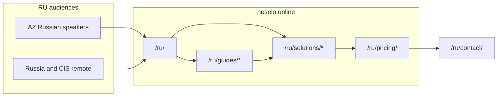

# Heselo /ru — vahid SEO planı (2026-10-16)

**Kanonik RU research.** Keyword map, rəqib teardown və native-copy qaydaları buradadır.
Cari icra planı: `docs/heselo-seo-growth-plan-2026-10-17.md` (audit: `docs/heselo-seo-deep-audit-2026-10-17.md`).

> **Doğrulanma:** ✅ = WebFetch/curl (2026-10-16) · 🔎 = axtarış snippeti · ❔ = təxmin.
> **Həcmlər:** Wordstat/GKP rəqəmləri uydurulmayıb. Yeganə mənbəli Wordstat: «как открыть компьютерный клуб» ≈ 2400/ay (Topvizor). Qalan prioritetlər SERP sıxlığına görə ❔.
> **Ziddiyyət:** V2 bölmələri v1-dən üstündür.


## Mündəricat

1. [Strategiya](#a-strategiya)
2. [Native RU qaydaları + context rule](#b-native-ru-qaydaları--context-rule)
3. [İcra fazaları 0–6](#c-icra-fazaları-06)
4. [Quick fixes (fayl→sətir)](#d-quick-fixes)
5. [30/60/90 + 12 həftə + todo indeks](#e-306090--12-həftə--todo-indeks)
6. [Mobile / CWV](#f-mobile--cwv)
7. [Araşdırma: keyword universe](#1-keyword-universe-ru) → rəqiblər, audit, gap, Yandex, off-site, V2
8. [Fayl xəritəsi](#g-fayl-xəritəsi)

---

## A. Strategiya

- **Məhsul:** Azərbaycan mənşəli SaaS; About/founder/NAP dürüst qalır.
- **Auditoriya:** (1) AZ-də rusdillilər, (2) Rusiya + CIS remote klublar.
- **Qiymət:** `/ru`-da **RUB göstərişi**; UI/meta/schema eyni valyuta. Billing AZN qala bilər → «ориентировочно» + mənbə/tarix.
- **Rəqiblər:** AZ comparison guide-ları silinmir (hreflang); `/ru` hub/teaser-də CIS-first (GameClub, LANGAME, iiko dürüst, category educational).
- **Axtarış:** Google primary; Yandex secondary (Webmaster + Metrica + IndexNow).
- **AZ/EN title-lara toxunma** — yalnız `ru` copy + locale-aware helpers.
- **Claim sərhədi:** ККТ/54-ФЗ/ЕГАИС, TV/işıq kontrolleri, PC shell — Heselo üçün iddia yox; FAQ-da dürüst «не делаем».



---

## B. Native RU qaydaları + context rule

### Copy qaydaları (hərfı tərcümə qadağan)

1. Source of truth = **SERP + native RU**, not `az.ts`/`en.ts`. Intent AZ/EN-dən gəlir; cümlə rusca yenidən yazılır.
2. **Calque reject:** «на полу», «Путь по сайту», «Малый/Средний/Большой», «живые сессии»+«сеансы» qarışıq, «программа (продукт)», «Гайды» vs nav «Статьи».
3. **SERP leksikon:** сеанс · тарификация · кабинка/станция · карта залов · предварительное бронирование · учёт времени · смена · касса · бар в счёт сеанса · программа для …
4. **B2B ton:** оператор dili; şişirtmə/emoji yox.
5. **Dual audience:** *создан в Баку · работает удалённо · панель на русском* — «только РФ» və ya yalnız Bakı stuffing yox.
6. **Title formula:** `Программа для [тип] — [бронь/сеансы/касса] | Heselo`
7. **QA:** «tərcümə iyi» → rewrite.

### Context rule (deliverable)

Fayl: `.cursor/rules/ru-seo-native-copy.mdc`

```yaml
---
description: Native Russian SEO/UI copy for /ru — no AZ/EN calque; SERP lexicon
globs: src/i18n/messages/ru.ts,src/data/solutions/ru.ts,src/data/guides/**/*ru*,src/data/guides/**/*Guide*.ts,docs/seo-ru*.md
alwaysApply: false
---
```

Rule body: yuxarıdakı 7 qayda + keyword mənbəyi bu sənəd + `docs/seo-ru-keyword-map.md` (qısa extract) + AZ/EN title-a toxunmama.

---

## C. İcra fazaları (0–6)

### Phase 0 — Baseline
GSC (AZ+RU+KZ+UZ+BY), Yandex Webmaster, Coverage `/ru/*`, PageSpeed/CrUX baseline, CSV.

### Phase 0b — Keyword map (DONE araşdırma; extract qalır)
Bu sənədin §1 + V2-2 → `docs/seo-ru-keyword-map.md` + kodda `KEYWORD_MAP_RU`. Wordstat/Trends CSV istifadəçi çəkir → V2-1 yenilənir.

### Phase 1 — Texniki framing
| İş | Nə |
|----|----|
| `geo.region` | `/ru`-da sil (`BaseLayout.astro`) |
| `areaServed` / country | AZ + RU/CIS, yalnız AZ yox |
| RUB | `formatMoney` / catalog / JSON-LD `priceCurrency` UI ilə eyni |
| eligibleRegion | AZ + RU |
| NAP | +994 qalır; Telegram + `heselo.online@gmail.com` (real mailbox) |

### Phase 2 — Native copy
Lexicon vahidləşdirmə → home/solutions/pricing/FAQ → guides. Diff yalnız `ru`.

### Phase 3 — Hubs + links
Locale-aware `TEASER_GUIDE_SLUGS` / `SOLUTION_ALT_GUIDES`; CIS-first; AZ POS soft de-emphasis; cannibalization həlli (§V2-2).

### Phase 3b — Content (brieflər §V2-4)
Top 10 məqalə + tools (tarif kalkulyatoru və s.) — doorway yox.

### Phase 4 — Mobile / CWV
§F aşağıda.

### Phase 5 — Off-site
§6 + V2-6.

### Phase 6 — Monitor
§V2-8 KPI; 7–14 gün GSC arasında fazalar.

**Nə etməmək:** saxta RF NAP/ККТ · AZ→RU calque · AZ/EN meta rewrite · nazik doorway · şəhər doorway · schema/UI valyuta uyğunsuzluğu.

---

## D. Quick fixes

| Fix | Fayl |
|---|---|
| H1 «на полу» → «Программы для клубов по типу заведения» | `src/data/solutions/ru.ts` |
| «живые сессии/сессия» → «сеанс» | `src/data/solutions/ru.ts`, `src/data/guides/ru.ts`, `src/i18n/messages/ru.ts` |
| Guides hub «Гайды» → «Статьи…» | `src/data/guides/ru.ts` |
| Home/solutions/pricing/faq title+meta (§4 + V2-4) | `src/i18n/messages/ru.ts`, `src/data/solutions/ru.ts` |
| LANGAME title → «Аналоги LANGAME: что выбрать для PS…» | `src/data/guides/langameAlternativeGuide.ts` |
| PS guide → «Как выбрать программу для PS-клуба: чек-лист» | `src/data/guides/playstationCafeSoftwareGuide.ts` |
| `geo.region=AZ` /ru-da sil | `src/layouts/BaseLayout.astro`, `src/lib/seo.ts` |
| RUB / priceCurrency | `src/lib/format.ts`, `src/lib/platformCurrency.ts`, `src/lib/catalogCopy.ts` |
| Telegram + korporativ email | contact/Footer/`site.ts` |
| Metrica deferred | `Analytics.astro`, privacy |
| Hub teaser CIS-first | `guides/types.ts`, `solutions/index.ts`, `GuidesTeaser.astro` |

Canlı audit detalları: **§4** aşağıda.

---

## E. 30/60/90 + 12 həftə + todo indeks

### 30/60/90
- **0–30:** quick fixes, geo.region, Metrica/Webmaster/IndexNow, Telegram+email, cannibalization, gaming + how-to-open-PS, kataloq ərizələri, Trends/Wordstat CSV.
- **31–60:** PS müqayisə 2026, antikafe, karaoke, revenue-control, qiymət modeli aləti, vc.ru, АРКИ, title A/B.
- **61–90:** bilyard açılış, LANGAME, lounge, ps-club-tariffs + kalkulyator, how-to-open-anticafe, RU keys/rəylər, AlternativeTo/Startpack, 90-gün review.

### 12 həftə
| Həftə | İş |
|---|---|
|1|Quick fixes + Metrica/Telegram + gaming solution|
|2|PS guide intent + cannibalization|
|3|how-to-open-PS dərinləşdirmə|
|4|ps-club-software-comparison NEW|
|5|antikafe solution + tarif məqaləsi|
|6|karaoke + guide kanonik|
|7|club-revenue-control NEW|
|8|bilyard açılış + billiards cila|
|9|LANGAME + lounge|
|10|ps-club-tariffs + tarif kalkulyatoru|
|11|how-to-open-anticafe + vc.ru|
|12|GSC/Webmaster review|

### Todo indeks (icra checklist)
- Baseline / data: GSC, Webmaster, Trends+Wordstat
- Rule: `.cursor/rules/ru-seo-native-copy.mdc`
- Keyword extract: `docs/seo-ru-keyword-map.md`
- Phase 1 RUB+geo+schema
- Quick fixes (yuxarı cədvəl)
- Cannibalization (PS guide, karaoke pair, management/automation/antikafe)
- Articles #1–#10 + ps-tariffs + open-anticafe + admin-shift (sonra)
- Tools: tariff-calculator, open-budget, pricing-model-compare
- Hub compare ItemList
- Trust: contacts, reviews
- Yandex: Webmaster, Metrica, IndexNow, Business
- Off-site: catalogs, media, communities
- Mobile Phase 4
- KPI 30/90 + plan review

---

## F. Mobile / CWV

1. LCP: `ProductShot` width variants + `sizes`; dar viewport-da məcburi @2x yox.
2. Hero: LCP node-dan `.reveal` delay çıxar.
3. CLS: `aspect-ratio` əvəzinə `max-height`+cover crop.
4. Clarity/Metrica: idle/first-interaction defer.
5. Font: Manrope woff2 preload.
6. Touch: locale ≥44px; pricing dots; FAB vs form padding.

Fayllar: `Hero.astro`, `ProductShot.astro`, `Analytics.astro`, `BaseLayout.astro`, `global.css`, `WhatsAppFab.astro`.

---

## Araşdırma (tam — əvvəlki v1 + v2)

Aşağıdakı bölmələr əvvəlki `seo-ru-research` v1/v2 məzmunudur (keyword, rəqib, audit, brieflər, off-site, Yandex, KPI).

## 1. Keyword universe (RU)
İntent: K = kommersiya (program axtarır), I = informasiya, N = naviqasiya/brend. Prioritet ❔ təxmindir.

### 1.1 Gaming / PlayStation (ən güclü uyğunluq)
| Sorğu | İntent | Prior. | Qalib URL |
|---|---|---|---|
| программа для игрового клуба | K | Y | /ru/solutions/gaming/ |
| программа для PlayStation-клуба / для PS клуба | K | Y | /ru/solutions/gaming/ |
| программа учёта игровых приставок | K | Y | /ru/solutions/gaming/ (H2) |
| учёт времени PlayStation / таймер для PS клуба | K | O | /ru/solutions/gaming/ |
| система управления игровым клубом | K | O | /ru/solutions/gaming/ (H1) |
| тарификация игровых приставок | K | O | /ru/guides/playstation-club-software/ |
| программа для PS клуба бесплатно / онлайн / облачная | K | O | /ru/solutions/gaming/ + FAQ |
| как открыть PS клуб / PlayStation клуб с нуля | I | Y | /ru/guides/how-to-open-playstation-club/ |
| сколько стоит открыть PS клуб 2026 | I | Y | **yeni** /ru/guides/ps-club-cost/ və ya mövcud how-to-open-a H2 |
| бизнес-план PS клуба / игровой комнаты | I | O | /ru/guides/how-to-open-playstation-club/ |
| окупаемость PS клуба / доходность | I | O | eyni (H2 + kalkulyator) |
| сколько PS5 нужно для клуба, цена часа PS5 | I | A | eyni (FAQ) |
| аналог GameClub / СмартТаймер | K | O | /ru/guides/gameclub-alternative/, /ru/guides/club-timer-alternative/ |
| программа для игрового клуба Алматы / Ташкент / Минск / Баку | K | A–O | /ru/solutions/gaming/ (body geo cümləsi, ayrıca doorway yox) |

### 1.2 PC / kompüter klubu (Heselo-nun zəif uyğunluğu: diskless/shell yoxdur)
| Sorğu | İntent | Prior. | Qalib URL |
|---|---|---|---|
| программа для компьютерного клуба | K | Y (çox rəqabət) | /ru/guides/langame-alternative/ — **yalnız dürüst "PC shell deyil" mövqeyi ilə** |
| аналоги LANGAME / альтернатива LANGAME | K | O | /ru/guides/langame-alternative/ |
| LANGAME или SmartShell / сравнение | K | O | eyni (cədvəl) |
| сколько стоит LANGAME / SmartShell цена | K | O | eyni (§2 qiymətləri) |
| как открыть компьютерный клуб | I | Y | Heselo üçün **prioritet yox** — T-Bank, Яндекс Пэй, IZI tutur; konversiya aşağı |
Qeyd: Rəqiblər (LANGAME, SmartShell, SENET, IZI) PC shell, diskless boot və oyunçu tətbiqi satır. Heselo-nun burada "əvəz edirik" demək hüququ yoxdur. Doğru bucaq: "konsol/qarışıq zal və ya PC-ləri olmayan otaqlar üçün".

### 1.3 Karaoke
| Sorğu | İntent | Prior. | Qalib URL |
|---|---|---|---|
| программа для караоке / для караоке-клуба | K | Y | /ru/solutions/karaoke/ |
| программа управления караоке-залами | K | O | /ru/solutions/karaoke/ |
| бронирование караоке-залов / система бронирования караоке | K | O | /ru/guides/karaoke-booking-system/ |
| почасовая оплата караоке-зала, тарификация | K | A | solutions/karaoke H2 |
| как открыть караоке, бизнес-план караоке | I | O | /ru/guides/karaoke-club-business-plan/ |
| автоматизация караоке r_keeper / iiko караоке | K | A | /ru/guides/restaurant-pos-vs-karaoke-system/ |

### 1.4 Bilyard
| Sorğu | İntent | Prior. | Qalib URL |
|---|---|---|---|
| программа для бильярдного клуба | K | Y | /ru/solutions/billiards/ |
| автоматизация бильярдного клуба / учёт времени бильярд | K | O | /ru/solutions/billiards/ |
| бронирование бильярдных столов / онлайн-запись на бильярд | K | O | /ru/guides/billiards-table-booking/ |
| управление светом над столом бильярда | K | A | **Heselo bunu etmir** — FAQ-da dürüst "контроллер света не поддерживаем" |
| как открыть бильярдный клуб | I | O | **yeni** guide (mövcud billiards-club-management ilə cannibalization yoxdur, o "idarə" intentidir) |

### 1.5 Antikafe / time-cafe
| Sorğu | İntent | Prior. | Qalib URL |
|---|---|---|---|
| программа для антикафе | K | Y | /ru/solutions/antikafe/ |
| учёт времени в антикафе / программа учёта времени посетителей | K | Y | /ru/solutions/antikafe/ |
| программа для тайм-кафе | K | O | /ru/solutions/antikafe/ (sinonim body/H2) |
| поминутная тарификация / стоп-чек (дневной потолок) | K | O | solutions/antikafe H2 |
| как открыть антикафе / бизнес-план антикафе | I | O | **yeni** və ya anticafe-rent-cost-calculation genişlənməsi |
| как рассчитать тарифы антикафе / цена минуты | I | O | /ru/guides/anticafe-rent-cost-calculation/ |
Qeyd: "стоп-чек" antikafe dilində geniş yayılmış termindir ❔ — rəqib səhifələrdə "дневной потолок" (GameClub) görünür ✅.

### 1.6 Lounge / qəlyan otaqları
| Sorğu | İntent | Prior. | Qalib URL |
|---|---|---|---|
| программа для кальянной | K | O (rəqiblər restoran/CRM tipli) | /ru/solutions/lounge/ |
| бронирование VIP-комнат / кабинок лаунж | K | A | /ru/solutions/lounge/ |
| CRM для кальянной | K | A | eyni |
Qeyd: Hookah.Work, Saby Presto, Restoplace, ReMarked 🔎 fiskal/ресторан dili ilə gəlir. Heselo-nun bucağı "otaq + vaxt + bar hesabda"dır.

### 1.7 Ümumi / funksiya sorğuları (title-a yox, body/features-ə)
учёт времени посетителей · тарификация по времени · онлайн-бронирование столов/комнат · карта зала · CRM для клуба · касса для клуба (ehtiyatla, ККТ iddiası yox) · программа для развлекательного центра · замена Excel для учёта клуба → /ru/features/, /ru/guides/club-pos-vs-excel/, /ru/guides/game-hall-automation/.

### 1.8 Sual formatlı long-tail (FAQ və H2 üçün)
- Как вести учёт времени в PS клубе без контроллера?
- Сколько стоит программа для игрового клуба в месяц?
- Можно ли добавить бар в счёт сеанса?
- Как настроить почасовой и пакетный тариф?
- Как принимать предварительную бронь без накладок?
- Как контролировать администратора на смене (кражи выручки)? — rəqiblərin əsas ağrı mesajı ✅ (СмартТаймер, GameClub)
- Нужна ли онлайн-касса? → dürüst cavab: "Heselo не является ККТ; в РФ используйте свою онлайн-кассу отдельно."

---

## 2. Rəqiblər
| Rəqib | URL | Title/H1 (✅ canlı) | Qiymət modeli | Güclü | Zəif / Heselo fərqi |
|---|---|---|---|---|---|
| GameClub | [gmclb.ru](https://gmclb.ru/) · [/playstation-club](https://gmclb.ru/playstation-club) · [/anticafe](https://gmclb.ru/anticafe) | «Программа для клуба PlayStation — учёт сеансов, тарифы, бронь»; H1 «Программа для PlayStation-клуба и Xbox-лаунжа» | Per-console; səhifədə «500 ₽ за консоль навсегда для первых 10 клубов» ✅, EN saytda $14/console 🔎; 30 gün pulsuz | **Ən birbaşa rəqib**: konsol-first, Telegram bot, ККТ, PWA bron, antikafe landing | Per-device qiymət böyüdükcə artır; Heselo per-venue (25–39 AZN) → "фиксированная цена за заведение" dürüst diferensiasiya; karaoke/bilyard/lounge bir paneldə |
| СмартТаймер (СофтБиллинг) | [smarttimer.ru](https://smarttimer.ru/) · [softbilling.ru](https://softbilling.ru/) | «Программа учета игровых приставок \| Тарификация и учет в игровом клубе» | Lisenziya + hardware (blok, kontroller) 🔎 | TV-ni söndürən kontroller = oğurluq nəzarəti; 10 il | Köhnə interfeys, hardware lazımdır; Heselo: brauzerdə, aparatsız. Heselo TV idarə etmir — bunu deməmək |
| SENET | [senet.cloud/ru/gaming-centers](https://senet.cloud/ru/gaming-centers) | «ПО для игровых клубов и киберспорта» | «от $3 за устройство», min 20 cihaz 🔎 ([IZI](https://izi.is/wiki/en/compare/langame-alternative/)) | Diskless boot, konsol kontrollerləri | Kiçik PS klub üçün ağır/bahalı |
| LANGAME | [langame.ru](https://langame.ru/) | Ana səhifə title-ı oyunçu marketpleysidir: «Все компьютерные клубы ищи и бронируй на LANGAME» ✅ | 800/1300/1800 ₽ per device/ay 🔎 (IZI capture) | 2000+ klub, oyunçu tətbiqi | PC-first; Heselo PC shell deyil |
| SmartShell | [smartshell.gg/price](https://smartshell.gg/price/) | «Сравнение тарифов и стоимость подписок SmartShell» | 280 / 580 / 1200 ₽ per seat/ay ✅ (snippet), 30 gün pulsuz | Ucuz, Telegram, API | PC-first |
| IZI | [izi.is wiki](https://izi.is/wiki/en/compare/langame-alternative/) | "Langame Alternative … 2026" | RF-də 2000 ₽/klub/ay flat 🔎 | **SEO dərsi**: müqayisə wiki-si ilə "аналоги LANGAME" SERP-ini tutur | — |
| Vi-Office Karaoke | [vi-office.com/ru/product/karaoke](https://vi-office.com/ru/product/karaoke) | Snippet title «Vi-Office Karaoke - программа управления караоке-залами»; canlı title generic ERP ✅ | açıq deyil ❔ | Карта залов, пиковый тариф, предварительное бронирование | Generic ERP, title zəif → Heselo karaoke üçün daha fokuslu title ilə qabaqlaya bilər |
| r_keeper (KZ) | [rkeeperpro.kz](https://www.rkeeperpro.kz/) 🔎 | «Программа для кафе и ресторанов в Алматы — r_keeper» | integrator | Karaoke modulu: депозит, тарификация | Restoran POS, inteqrator xərci |
| BookNow / EasyWeek | [easyweek.ru/solutions/billiards](https://easyweek.ru/solutions/billiards) | «CRM для бильярдного зала \| ПО для бильярдного зала» | abunə ❔ | Onlayn yazılış vidjeti | Canlı seans/kassa yoxdur — Heselo: bron + seans + kassa |
| Smartbit Billiard (KZ) | [smartbit.kz](https://smartbit.kz/) | «Автоматизация бильярдного клуба» | ❔ | Mobil, işıq, sauna/tennis | KZ-də Heselo-nun birbaşa rəqibi |
| ClubSystem | [clubsystem.app](https://www.clubsystem.app/) 🔎 | Billiard Table Booking System | $43/ay-dan + per station 🔎 | SMS təsdiq, işıq | EN, RU zəif |
| YTimes | [ytimes.ru](https://ytimes.ru/) | «Программа учета кофейни, кафе, бара, антикафе» | 1490 ₽/ay ✅ (snippet) | Antikafe vaxt ödənişi + общепит | Qəhvəxana-first |
| Axle-CRM | [axle-crm.com/spheres/timecafe](https://axle-crm.com/spheres/timecafe) | «CRM для автоматизации антикафе» | ❔ | Hər nişə landing (SEO doorway modeli) | Generic CRM |
| УСУ | [ususoft.com](https://ususoft.com/rus/anticafe.php) 🔎 | «Программа для антикафе» | birdəfəlik lisenziya | — | Köhnə desktop |
| Hookah.Work | [hookah.work](https://hookah.work/) | «CRM для кальянной Hookah.Work» | ❔ | Nişə brend | Otaq/vaxt fokusu yoxdur |
| iiko / Poster / Quick Resto | [iiko.ru](https://iiko.ru/) · [joinposter.com](https://joinposter.com/) | «Cистема автоматизации ресторанов и кафе» / «программа автоматизации общепита» | per terminal | ККТ/ЕГАИС, ekosistem | Vaxt tarifikasiyası zəif/yoxdur — dürüst "не ресторанный POS" |
| YCLIENTS | [yclients.com](https://www.yclients.com/) | «онлайн-запись и автоматизация» | «от 1600 ₽/мес» 🔎 | Bron | Salon-first, seans/bar hesabı yoxdur |
| iCafeCloud / HandyCafe | [icafecloud.com](https://www.icafecloud.com/) · [handycafe.com](https://www.handycafe.com/) | EN cyber-cafe | per PC | PC shell | RU SERP-də zəif |
| PanCafe | pancafe.pro — **əlçatmaz (timeout)** ❔ | — | — | — | Guide qalır, amma CIS hub-da önə çəkmə |
| Clopos | [clopos.com](https://clopos.com/) | AZ dilində restoran POS | — | AZ bazarı | RU SERP-də ❔ zəif |
Kataloqlar: [a2is.ru — Программы для компьютерного клуба](https://a2is.ru/catalog/programmy-dlya-kompyuternogo-kluba) (LANGAME vs SmartShell müqayisə səhifələri SERP-də var 🔎), [crmindex.ru/for/computer_club](https://crmindex.ru/for/computer_club) ✅.

---

## 3. Content gap və məqalə planı (prioritet sırası)
Cannibalization yoxlaması: sitemap-də 57 /ru URL ✅. Aşağıda "mövcud" = sitemap-də var.

1. **/ru/solutions/gaming/ (mövcud, cila)** — KW: программа для игрового клуба, программа для PS клуба, учёт игровых приставок. H1: «Программа для игрового клуба и PlayStation-клуба». H2: Учёт сеансов и таймер · Почасовая и пакетная тарификация · Бар в счёт сеанса · Смены и касса администратора · Предварительное бронирование кабинок · Цена — фиксированная за клуб, не за консоль · Работает без контроллеров (dürüst: TV-ni idarə etmir). FAQ: Сколько стоит? Нужен ли контроллер? Работает ли в Казахстане/Узбекистане? Есть ли ККТ? (yox). Schema: SoftwareApplication + FAQPage + BreadcrumbList. Links → pricing, playstation-club-software, how-to-open, gameclub-alternative.
2. **Yeni: /ru/guides/ps-club-software-comparison/ «Программа для PS-клуба: сравнение 2026»** — KW: программа для PS клуба сравнение, GameClub или СмартТаймер. Intent K. H2: Критерии · Таблица (GameClub, СмартТаймер, SENET, SmartShell, Heselo — модель цены, контроллер, бронь, бар) · Цена на 5/10 консолей · Когда Heselo не подходит. Qeyd: mövcud gameclub-alternative/club-timer-alternative ilə **hub-spoke** — o səhifələrə link ver, eyni KW-ni title-da təkrarlama. Schema: Article + ItemList + FAQPage.
3. **/ru/guides/how-to-open-playstation-club/ (mövcud, dərinləşdir)** — KW: как открыть PS клуб, сколько стоит открыть PS клуб 2026, бизнес-план. Rəqib: [Enextware](https://enextware.com.tr/ru/blog/skolko-stoit-otkryt-ps-klub-2026) ✅, [invastartup PDF](https://invastartup.ru/) 🔎. H2: Формат и помещение · Оборудование (PS5, ТВ, мебель) · Бюджет по статьям (RUB/AZN, şərti, mənbə ilə) · Тарифы и загрузка · Окупаемость · Документы (ümumi, ölkəyə görə fərqlidir) · Программа учёта. FAQ: Сколько нужно консолей? Какая окупаемость? Нужна ли лицензия на игры? Schema: Article/HowTo + FAQPage. Rəqəmləri **mənbəsiz yazma**.
4. **/ru/solutions/antikafe/** — title-a «учёт времени» əlavə et (§4). H2: Поминутная тарификация · Стоп-чек / дневной потолок · Пакеты · Бар/снеки в счёт · Комнаты под бронь. FAQ antikafe sualları.
5. **/ru/guides/anticafe-rent-cost-calculation/** → title «Как рассчитать тарифы антикафе: формула цены минуты». KW: как рассчитать тарифы антикафе, цена минуты антикафе.
6. **/ru/solutions/billiards/** + yeni **/ru/guides/how-to-open-billiards-club/** «Как открыть бильярдный клуб: расходы и окупаемость». FAQ: управление светом (dürüst: yox).
7. **/ru/solutions/karaoke/** — title «Программа для караоке — бронь залов, тарифы, касса | Heselo»; H2: Карта залов · Пиковый/обычный тариф · Депозит (əgər məhsulda yoxdursa yazma) · Бар в счёт зала.
8. **/ru/guides/langame-alternative/** — title yenidən: «Аналоги LANGAME: что выбрать для PS и смешанного клуба | Heselo». Cədvəldə LANGAME/SmartShell/SENET/IZI qiymətləri mənbə + tarix ilə.
9. **Yeni: /ru/guides/kak-vesti-uchet-vremeni-v-klube/ «Как вести учёт времени в клубе: тетрадь, Excel или программа»** — mövcud club-pos-vs-excel ilə **birləşdir** (yeni URL açmadan title/H1 dəyiş) — cannibalization riski.
10. **/ru/solutions/lounge/** — «Программа для кальянной и лаунжа с VIP-комнатами».
Sonra (aşağı): «Как контролировать администратора в игровом клубе», «Тарифы PS клуба: почасовые, пакеты, ночь».

**Hub:** `/ru/guides/` "Гайды" → «Статьи»; /ru-da AZ POS guide-larını (kassa-az, baza-market, fazilat, tendir, hasansoft, akinsoft…) teaser-dən çıxar (plan ilə uyğun).

---

## 4. Canlı /ru audit (✅ curl 2026-10-16)
| URL | İndiki title / H1 | Problem | Təklif title / description |
|---|---|---|---|
| /ru/ | «Heselo — панель брони и кассы для клубов и комнат»; desc «живая сессия … От 25 AZN» | Brend-first, əsas KW yoxdur; «сессия»; AZN | «Программа для игрового клуба, караоке и антикафе — бронь, сеансы, касса \| Heselo» / «Учёт сеансов, почасовая тарификация, бар в счёт и смены администратора в одной онлайн-панели. Фиксированная цена за заведение. Бесплатное демо.» |
| /ru/solutions/ | H1 «Какой тип заведения у вас на полу?» | **calque «на полу»** | H1 «Программы для клубов по типу заведения»; title «Программа для клуба: PS, караоке, бильярд, антикафе \| Heselo» |
| /ru/solutions/gaming/ | «Программа для PlayStation клуба — бронь и касса»; desc «живые сессии», «playstation» kiçik hərf | дефис yoxdur, «сессии» | «Программа для игрового и PlayStation-клуба — сеансы, бронь, касса \| Heselo» / «Учёт сеансов PS5 и Xbox, почасовые и пакетные тарифы, бар в счёт сеанса и смены. Без контроллеров, в браузере. Демо бесплатно.» |
| /ru/solutions/karaoke/ | «Система управления караоке и бронь комнат» | «комнат» → karaoke dilində «залов»; «сессии» | «Программа для караоке — бронь залов, тарификация, касса \| Heselo» |
| /ru/solutions/billiards/ | OK, desc «живые сессии» | сессии | «Программа для бильярдного клуба — бронь столов, учёт времени, касса \| Heselo» |
| /ru/solutions/antikafe/ | «Система управления антикафе и программа для антикафе» | KW təkrarı | «Программа для антикафе — учёт времени, поминутные тарифы, касса \| Heselo» |
| /ru/solutions/lounge/ | «Программа для лаунж-бара и бронь VIP-комнат»; «От 39 AZN» | AZN | «Программа для лаунжа и кальянной — бронь VIP-комнат, бар, касса \| Heselo» |
| /ru/pricing/ | «Открытые тарифы — клубная панель от 25 AZN» | AZN, «клубная панель» calque | «Цены на программу для клуба — от ≈… ₽ в месяц за заведение \| Heselo» (RUB yalnız Phase 1 bitəndə; disclaimer «оплата в AZN, рубли ориентировочно») |
| /ru/guides/ | «Гайды — …» | nav «Статьи» ilə uyğunsuz | «Статьи для владельцев клубов: учёт, тарифы, выбор программы \| Heselo» |
| /ru/guides/langame-alternative/ | «Альтернатива LANGAME — ПО PC-клуба vs Heselo»; desc «— AZ, EN, RU» | calque/qarışıq, desc-də dil siyahısı | §3.8 |
| /ru/guides/playstation-club-software/ | «Программа для PlayStation-клуба — основные функции» | **gaming solution ilə eyni head KW → cannibalization** | «Как выбрать программу для PS-клуба: чек-лист функций \| Heselo» |
| /ru/guides/iiko-alternative-clubs/ | «Замена iiko для клубов …» | yaxşı | saxla |
| /ru/faq/ | «Частые вопросы (FAQ)»; «от 25 AZN» | AZN | Phase 1 ilə |
Ümumi: bütün /ru səhifələrində `<meta name="geo.region" content="AZ">` ✅ — planın Phase 1-də silmək düzgündür. Ana səhifədə «сесси» 3 dəfə ✅.

---

## 5. Texniki / Yandex
- **Turbo bitib:** Yandex Turbo dəstəyini dayandırıb, Webmaster bölməsi bağlanıb ✅ [blog](https://webmaster.yandex.ru/blog/yandex-stops-supporting-turbo-technology). Heç nə etmək lazım deyil.
- **Regionallıq:** Webmaster-də region təyin olunur; geo-asılı sorğularda nəzərə alınır, digər regionlarda saytı istisna etmir 🔎 [Yandex help](https://yandex.ru/support/webmaster/ru/site-geography/site-region). B2B SaaS sorğuları əsasən geo-asılı deyil ❔. Tövsiyə: region = «Азербайджан» (dürüst NAP) və ya boş. RF şəhəri yazma.
- **ИКС:** sıralamaya birbaşa təsir etmir, formul açıqlanmır 🔎 [help](https://www.yandex.ru/support/webmaster/ru/site-quality-index). Brend axtarışı, Yandex Business və trafiklə böyüyür.
- **Davranış faktorları (Yandex):** pogo-sticking riski: title vəd etdiyini (qiymət, ₽) ilk ekranda göstər; qiymət cədvəli, demo CTA, Metrica — **Yandex Metrica** quraşdırmaq məsləhətdir ❔ (Vebvizor + Webmaster-lə əlaqə).
- **Yandex Business:** yalnız real Bakı ünvanı ilə (plan ilə uyğun). Bu, ИКС və brend siqnalı verir.
- **hreflang:** hazırda `ru` + `x-default` ✅. **Qərar: `ru` saxla**, `ru-RU`/`ru-KZ` variantları açma. Məzmun eynidir, ayrı versiyalar dublikat/doorway yaradar. Yandex hreflang-ı Google qədər istifadə etmir ❔.
- **Valyuta:** RUB yalnız "ориентировочно" + billing AZN cümləsi ilə; JSON-LD `priceCurrency` UI ilə eyni olsun. Kurs mənbəyi və tarixi göstər (məs. «по курсу ЦБ на …»). Əks halda Yandex/Google "misleading" riski var.
- **IndexNow + sitemap** artıq var (plan). Webmaster-də "Важные страницы"-ə solutions/* əlavə et.

## 6. Off-site (RU/MDB)
- **Kataloqlar:** [a2is.ru](https://a2is.ru/catalog/programmy-dlya-kompyuternogo-kluba) (kompüter klubu kateqoriyası var; antikafe/karaoke kateqoriyası olub-olmadığını yoxla), [crmindex.ru](https://crmindex.ru/for/computer_club), Startpack.ru ❔, «Сравни CRM» ❔, Capterra/G2 RU-da az təsirli. AlternativeTo: LANGAME/GameClub səhifələrinə "alternative" kimi əlavə et.
- **Rəqib wiki modeli:** IZI özünü müqayisə wiki-ləri ilə SERP-də göstərir 🔎. Heselo da üçüncü tərəf siyahılarına daxil olmağa çalışmalıdır: IZI və a2is müəlliflərinə yaz.
- **İcmalar ❔ (adları yoxlanmayıb):** Telegram-da "владельцы компьютерных/PS клубов" çatları; VK-da "Компьютерные клубы — бизнес", antikafe icmaları; vc.ru (case yazısı "как мы автоматизировали PS-клуб в Баку"); Pikabu/Habr (texniki hekayə); YouTube-da PS klub açılış bloqerləri (demo).
- **Franchise saytları:** franch-home.ru-da PS klub franşizaları 🔎 — tərəfdaşlıq və ya reklam.
- **AI görünürlüyü:** eyni təsvirlə (`Heselo — программа для игровых клубов, караоке, бильярда и антикафе; фиксированная цена за заведение; создан в Баку`) kataloqlar, vc.ru, Telegram və müqayisə məqalələrində yer al. ChatGPT bu cür müqayisə səhifələrindən sitat gətirir.

## 7. Nə doğrulanıb, nə təxmindir
- ✅ Canlı yoxlanıb: Heselo /ru title/H1/desc, sitemap /ru siyahısı, `geo.region=AZ`; rəqib URL-lərin 200 statusu və title-ları (PanCafe timeout); GameClub "500 ₽ за консоль" mətni; Yandex Turbo bloq səhifəsi.
- 🔎 Axtarış snippetindən: LANGAME/SmartShell/SENET/IZI/YCLIENTS qiymətləri (IZI wiki-nin 2026-08/09 capture-u), ClubSystem $43, YTimes 1490 ₽, a2is reytinqləri.
- ❔ Təxmin: bütün prioritetlər (həcm deyil), icma adları, Yandex davranış tövsiyələri, "стоп-чек" termininin yayılması.
- ❌ Axtarış həcmləri: heç biri tapılmayıb. Wordstat-dan çəkmək lazımdır.

---
---

# v2 — Dərinləşdirilmiş araşdırma (2026-10-16, 20:30 UTC+4)
> v1-dəki §1–§7 qüvvədədir. v2 bölmələri onları genişləndirir; ziddiyyət olarsa **v2 üstündür**. Etiketlər eynidir: ✅ canlı yoxlanıb · 🔎 axtarış snippeti · ❔ təxmin.

## V2-1. Tələb datası (həcmlər)
### Tapılan real, mənbəli rəqəmlər (yalnız bunlar)
| Fakt | Rəqəm | Mənbə | Status |
|---|---|---|---|
| «как открыть компьютерный клуб», Wordstat | **2400 показов/ay** (nişin "əsas sorğusu" kimi; ilin dəqiq ayı göstərilməyib) | [Топвизор-Журнал, SEO keys CRM для компьютерных клубов, 2025](https://journal.topvisor.com/ru/championship/2025-seo-for-crm-system/) ✅ | yeganə tapılan Wordstat rəqəmi |
| Eyni keys: nişdə semantik nüvə | 1200+ sorğu; sayt ~6000 vizit/ay, əsasən brend | eyni ✅ | niş dar, brend dominant |
| Yandex Карты: «компьютерный клуб» axtarışları, Moskva + MO | yanvar 2025-də **230 min+**, fevral 2024-də 93 min (~2,5×) | [Postnews, 2025](https://postnews.ru/a/33822) ✅ | Xəritə axtarışıdır, web deyil — B2C tələb siqnalı |
| Moskva+MO-da «компьютерный клуб» təşkilatları | 586 (01.02.2025), il əvvəl 453 | eyni ✅ | bazar (B2B alıcı sayı) böyüyür |
| RF-də kompüter klubları sayı | 2024 sonu **3100+** | [LANGAME 2024 итоги](https://langame.ru/342_statia_langame-2024-itogi-goda-cast-iii-lyudi) 🔎 | TAM ölçüsü |
| Klub ziyarətçiləri / seanslar | ~1,25 mln unikal/ay; klub başına 2,57 min seans/ay | [АРКИ Барометр 2025](https://arki.team/results/barometer) ✅ | bazar sağlamdır |
| Antikafe trafiki 2026 | yanvar–may 2026: +4–8% y/y; zəif nöqtələr bağlanır | [РГ, 26.05.2026](https://rg.ru/2026/05/26/kak-izmenilsia-spros-na-antikafe-v-2026-godu.html) ✅ | antikafe — kiçik, stabil niş |
| Sezonluq (kompüter klubu) | yüksək mövsüm **sentyabr–mart** | [vc.ru, Челябинск keysi](https://vc.ru/life/2150432-kak-otkryt-kompyuternyy-klub-v-chelyabinske) ✅ | "открыть клуб" məzmununu avqust–sentyabrda yayımla ❔ |

### Əlçatan olmayanlar
- **Google Trends**: API box-dan 400 qaytardı; UI giriş tələb edir. **Klasterlərin nisbi müqayisəsi (ru/kz/by/uz/az) aparılmayıb** — hər hansı rəqəm təxmin olardı. Yoxlama addımı: trends.google.com → «игровой клуб», «PS клуб», «антикафе», «бильярдный клуб», «караоке» (5 termin, 5 il, hər ölkə ayrıca) → CSV-ni `docs/`-a qoy.
- **Wordstat**: login tələb edir; API (`/v1/topRequests`, `/v1/dynamics`, `/v1/regions`) mövcuddur ([Yandex docs](https://yandex.com/support2/wordstat/en/content/api-structure) 🔎) — OAuth token ilə istifadəçi özü çəkə bilər. Qeyd: Wordstat rəqəmi = показы, unikal adam deyil ([Sostav 2026](https://www.sostav.ru/blogs/286273/103997) 🔎).
### Nəticə (❔ təxmin, yuxarıdakılara əsasən)
"Как открыть компьютерный клуб" 2400 olarsa, B2B kommersiya sorğuları («программа для компьютерного клуба» və s.) bundan **xeyli az** olmalıdır (niş dar, sayt brend trafiki ilə yaşayır). PS/antikafe/bilyard proqram sorğuları ayda **onlarla–yüzlərlə** ola bilər — hər klik dəyərlidir, amma "trafik oyunu" yox, **dəqiq intent + konversiya** oyunudur.

## V2-2. Genişləndirilmiş keyword universe (110 sorğu)
Leqenda: İntent K=kommersiya, C=müqayisə, I=informasiya, O=как открыть, P=qiymət, X=ağrı. SERP: V=vendor dominant, A=aqreqator/media dominant, M=qarışıq (🔎/❔ — v1 axtarışlarından). Qalib: mövcud URL və ya **NEW**. ⚠ = cannibalization riski.

### A. Gaming / PlayStation (32)
| # | Sorğu | İnt | SERP | Qalib |
|---|---|---|---|---|
|1|программа для игрового клуба|K|V (GameClub, SENET)|/ru/solutions/gaming/|
|2|программа для PlayStation клуба|K|V (GameClub, СмартТаймер)|/ru/solutions/gaming/|
|3|программа для PS клуба|K|V|/ru/solutions/gaming/|
|4|программа для клуба PS5|K|V|/ru/solutions/gaming/|
|5|программа для консольного клуба|K|V|/ru/solutions/gaming/|
|6|программа учёта игровых приставок|K|V (СмартТаймер)|/ru/solutions/gaming/ (H2)|
|7|учёт времени PlayStation|K|V|/ru/solutions/gaming/|
|8|таймер для PS клуба|K|V|/ru/solutions/gaming/|
|9|тарификация игровых приставок|K|V|/ru/solutions/gaming/ ⚠ playstation-club-software|
|10|система управления игровым клубом|K|V|/ru/solutions/gaming/|
|11|CRM для игрового клуба|K|A (crmindex)|/ru/solutions/gaming/|
|12|облачная программа для PS клуба|K|V|/ru/solutions/gaming/ (FAQ)|
|13|программа для PS клуба бесплатно|K|M|/ru/pricing/ (demo/FAQ) |
|14|программа для Xbox клуба|K|V|/ru/solutions/gaming/ (body)|
|15|как выбрать программу для PS клуба|I/C|M|/ru/guides/playstation-club-software/|
|16|программа для PS клуба сравнение|C|A|**NEW** /ru/guides/ps-club-software-comparison/|
|17|GameClub отзывы / аналог GameClub|C|V|/ru/guides/gameclub-alternative/|
|18|СмартТаймер аналог|C|V|/ru/guides/club-timer-alternative/|
|19|как открыть PS клуб|O|A (T-Bank, Яндекс Пэй, vc.ru)|/ru/guides/how-to-open-playstation-club/|
|20|как открыть PlayStation клуб с нуля|O|A|eyni|
|21|сколько стоит открыть PS клуб|O/P|A (Enextware, telegra.ph)|eyni (H2) ⚠ NEW cost page — **birləşdir, ayrıca açma**|
|22|бизнес-план PS клуба|O|A (PDF-lər)|eyni (H2 + şablon)|
|23|окупаемость PS клуба|O|A|eyni (H2)|
|24|PS клуб как бизнес отзывы|O|A (vc.ru)|eyni (FAQ)|
|25|сколько стоит час PS5 в клубе|I|A|**NEW** /ru/guides/ps-club-tariffs/|
|26|тарифы PS клуба / пакеты / ночной тариф|I|M|**NEW** /ru/guides/ps-club-tariffs/|
|27|оборудование для PS клуба|O|A|how-to-open (H2)|
|28|лицензия на игры для PS клуба|I|M|how-to-open FAQ (ehtiyatla, hüquqi məsləhət yox)|
|29|программа для игрового клуба Алматы / Астана|K|V (yerli)|/ru/solutions/gaming/ (body: «работаем в Казахстане удалённо»)|
|30|программа для PS клуба Ташкент|K|❔|eyni|
|31|программа для игрового клуба Минск|K|❔|eyni|
|32|программа для PS клуба Баку|K|❔ (Heselo üstünlüyü)|eyni + /ru/about/|

### B. PC / kompüter klubu (14) — Heselo zəif uyğun; yalnız müqayisə/dürüst
|#|Sorğu|İnt|SERP|Qalib|
|---|---|---|---|---|
|33|программа для компьютерного клуба|K|V (LANGAME, SmartShell, SENET)|/ru/guides/langame-alternative/ (aşağı prioritet)|
|34|аналоги LANGAME|C|A (IZI wiki)|/ru/guides/langame-alternative/|
|35|альтернатива LANGAME|C|A|eyni|
|36|LANGAME или SmartShell|C|A (a2is)|eyni (cədvəl)|
|37|SmartShell цена|P|V|eyni (cədvəl)|
|38|LANGAME цена|P|V|eyni|
|39|SENET отзывы|C|A|eyni|
|40|IZI аналог|C|V|/ru/guides/izi-alternative/|
|41|как открыть компьютерный клуб (2400 ✅)|O|A|**hədəfləmə** — konversiya çox aşağı; yalnız PS zona H2 ilə how-to-open-a link ❔|
|42|сколько стоит открыть компьютерный клуб|O|A|hədəfləmə|
|43|обязанности администратора компьютерного клуба|I|A|**NEW** /ru/guides/club-administrator-shift/ (PS+bilyard üçün ümumi)|
|44|PS зона в компьютерном клубе|I|❔|how-to-open H2|
|45|программа для компьютерного клуба с консолями|K|V|/ru/solutions/gaming/|
|46|компьютерный клуб программа учёта бара|K|V|/ru/solutions/gaming/ (bar H2)|

### C. Karaoke (12)
|#|Sorğu|İnt|SERP|Qalib|
|---|---|---|---|---|
|47|программа для караоке|K|M (Vi-Office, r_keeper)|/ru/solutions/karaoke/|
|48|программа для караоке-клуба|K|M|eyni|
|49|программа управления караоке-залами|K|V (Vi-Office)|eyni|
|50|автоматизация караоке|K|V (r_keeper)|eyni|
|51|система бронирования караоке|K|M|/ru/guides/karaoke-booking-system/ ⚠ karaoke-room-booking — **ikisindən birini kanonik et**|
|52|бронирование караоке-залов онлайн|K|M|/ru/guides/karaoke-booking-system/|
|53|почасовая оплата караоке-зала|I|❔|/ru/solutions/karaoke/ H2|
|54|караоке r_keeper / iiko караоке|C|V|/ru/guides/restaurant-pos-vs-karaoke-system/|
|55|как открыть караоке|O|A|/ru/guides/karaoke-club-business-plan/|
|56|бизнес-план караоке-бара|O|A|eyni|
|57|караоке кабинки бизнес|O|❔|eyni (H2)|
|58|программа для караоке Алматы / Москва|K|V (rkeeperpro.kz)|/ru/solutions/karaoke/|

### D. Bilyard (12)
|#|Sorğu|İnt|SERP|Qalib|
|---|---|---|---|---|
|59|программа для бильярдного клуба|K|V (СофтБиллинг, Smartbit)|/ru/solutions/billiards/|
|60|автоматизация бильярдного клуба|K|V|eyni|
|61|программа учёта бильярдных столов|K|V|eyni|
|62|учёт времени бильярд|K|V|eyni|
|63|CRM для бильярдного зала|K|V (BookNow)|eyni|
|64|бронирование бильярдных столов|K|M|/ru/guides/billiards-table-booking/|
|65|онлайн-запись на бильярд|K|M|eyni|
|66|управление светом бильярдных столов|K|V (СофтБиллинг)|**hədəfləmə** — funksiya yoxdur; FAQ-da dürüst|
|67|как открыть бильярдный клуб|O|A|**NEW** /ru/guides/how-to-open-billiards-club/|
|68|сколько стоит открыть бильярдную|O/P|A|eyni NEW|
|69|цена часа бильярда как рассчитать|I|❔|eyni NEW (H2)|
|70|программа для бильярда Казахстан|K|V (smartbit.kz)|/ru/solutions/billiards/|

### E. Antikafe / time-cafe (12)
|#|Sorğu|İnt|SERP|Qalib|
|---|---|---|---|---|
|71|программа для антикафе|K|V (GameClub, YTimes, УСУ)|/ru/solutions/antikafe/|
|72|программа для тайм-кафе|K|V|eyni|
|73|учёт времени в антикафе|K|V|eyni|
|74|программа учёта времени посетителей|K|M|eyni|
|75|CRM для антикафе|K|V (Axle)|eyni|
|76|поминутная оплата антикафе программа|K|V|eyni|
|77|стоп-чек антикафе|I|❔|eyni (H2) — termin ❔ Wordstat ilə yoxla|
|78|как открыть антикафе|O|A|**NEW** /ru/guides/how-to-open-anticafe/ ⚠ anticafe-rent-cost-calculation|
|79|бизнес-план антикафе|O|A|eyni NEW|
|80|как рассчитать тарифы антикафе|I|❔|/ru/guides/anticafe-rent-cost-calculation/|
|81|цена минуты в антикафе|I|❔|eyni|
|82|антикафе с PlayStation / настолки|I|❔|/ru/solutions/antikafe/ body|

### F. Lounge / qəlyan (8)
|#|Sorğu|İnt|SERP|Qalib|
|---|---|---|---|---|
|83|программа для кальянной|K|V (Hookah.Work, Saby, Restoplace)|/ru/solutions/lounge/|
|84|CRM для кальянной|K|V|eyni|
|85|программа для лаунж-бара|K|❔|eyni|
|86|бронирование VIP-комнат|K|❔|eyni|
|87|почасовая аренда VIP-комнаты учёт|K|❔|eyni|
|88|лаунж с PS / кальянная с PlayStation|I|❔|/ru/solutions/lounge/ + gaming link|
|89|как открыть кальянную|O|A|**hədəfləmə yox** (tütün/hüquqi risk, intent uzaq)|
|90|программа для кальянной с бронью столов|K|V (Restoplace)|/ru/solutions/lounge/|

### G. Generic / funksional (10)
|#|Sorğu|İnt|SERP|Qalib|
|---|---|---|---|---|
|91|программа учёта времени для клуба|K|M|/ru/ (home)|
|92|тарификация по времени программа|K|M|/ru/features/|
|93|онлайн-бронирование столов и комнат|K|M (Restoplace, YCLIENTS)|/ru/solutions/reservations/|
|94|карта зала онлайн|K|❔|/ru/features/|
|95|CRM для клуба|K|A|/ru/|
|96|программа для развлекательного центра|K|M|/ru/solutions/|
|97|учёт смен администратора|K|❔|/ru/features/ + NEW admin guide|
|98|программа для клуба вместо Excel|I|❔|/ru/guides/club-pos-vs-excel/|
|99|касса для клуба без ресторанного POS|C|❔|/ru/guides/affordable-club-pos/|
|100|альтернатива iiko для клуба|C|V (iiko analog listləri — общепит)|/ru/guides/iiko-alternative-clubs/|

### H. Ağrı / problem (10) — yüksək konversiya ❔
|#|Sorğu|İnt|SERP|Qalib|
|---|---|---|---|---|
|101|администратор ворует в клубе|X|❔ (forum)|**NEW** /ru/guides/club-revenue-control/|
|102|кража выручки в игровом клубе|X|V (СмартТаймер dili)|eyni NEW|
|103|как контролировать администратора клуба|X|❔|eyni NEW|
|104|как избежать накладок в бронировании|X|❔|/ru/solutions/reservations/|
|105|клиенты не приходят по брони|X|❔|eyni (FAQ: депозит/подтверждение — yalnız məhsulda varsa)|
|106|учёт бара в игровом клубе|X|V|/ru/solutions/gaming/|
|107|как посчитать загрузку клуба|X|❔|NEW admin/report guide|
|108|ошибки при открытии PS клуба|X/O|A|how-to-open (H2)|
|109|как поднять выручку PS клуба|X|A (GameClub blog)|**NEW** /ru/guides/ps-club-revenue/ (sonra)|
|110|как привлечь клиентов в игровой клуб|X|V (GameClub blog ✅)|eyni NEW (sonra)|

### Sinonim lüğəti (copy üçün)
игровой клуб = PS-клуб = PlayStation-клуб = консольный клуб = клуб приставок · кабинка = игровое место = станция · антикафе = тайм-кафе = тайм-клуб · бильярдная = бильярдный клуб = бильярдный зал · караоке-зал = караоке-кабинка = караоке-комната (RU-da «зал» dominant 🔎) · учёт времени = тарификация · бронь = бронирование = запись.
### Cannibalization xülasəsi
1. gaming ↔ playstation-club-software (eyni head KW) → guide = «как выбрать … чек-лист».
2. karaoke-booking-system ↔ karaoke-room-booking → biri kanonik, digəri fərqli intent (məs. «как организовать бронь караоке без накладок») və ya 301 (deploy qərarı istifadəçidə).
3. gaming-club-management ↔ game-hall-automation ↔ gaming solution → management = «как управлять PS-клубом: смены, тарифы, отчёты», automation = «что автоматизировать», solution = proqram.
4. antikafe-management-system ↔ solutions/antikafe → guide-u informasiya intentinə köçür.
5. how-to-open-PS ↔ yeni cost səhifəsi → ayrıca açma.

## V2-3. Rəqib teardown (✅ curl, 2026-10-16)
| Rəqib | Title | H1 | H2 outline (qısaldılmış) | Söz sayı ~ | Schema | Qiymət | Blog/məzmun | Etibar siqnalları | Backlink izləri |
|---|---|---|---|---|---|---|---|---|---|
| **GameClub** [gmclb.ru](https://gmclb.ru/) | «GameClub - система управления игровым клубом \| PlayStation, Xbox, PC» | «Программа для PlayStation-клуба и Xbox-лаунжа» | Один продукт — четыре типа клубов · знакомая боль? · К концу дня вы знаете… · Всё, что нужно · Запуск за 15 минут · Простые тарифы · FAQ | ~1200 (home), ~390 (/playstation-club) | SoftwareApplication, Offer, FAQPage, Organization | ana səhifədə ₽ rəqəmləri (500 ₽/konsol promo, 1000₽, 9 000₽/ay nümunə) ✅ | [/blog](https://gmclb.ru/blog) ✅: 6 məqalə (как открыть игровой клуб, сколько стоит, как открыть клуб PlayStation, оборудование, как привлечь клиентов, бизнес-план) | 30 gün pulsuz, ККТ, Telegram bot | ❔ tapılmadı |
| **СмартТаймер** [smarttimer.ru](https://smarttimer.ru/) | «Программа учета игровых приставок \| Тарификация и учет…» | «Программа для компьютерного клуба СмартТаймер» | yalnız 1 H2 | ~1100 | **yoxdur** | qiymət açıq deyil (lisenziya+hardware) | blog yoxdur | "10 il", "окупаемость 2–4 недели" iddiası | köhnə domen ❔ |
| **LANGAME** [langame.ru/software](https://langame.ru/software) | «Софт для управления компьютерным клубом LANGAME» | «Лидирующее программное обеспечение для компьютерных клубов» | Клуб – это бизнес · 2000 клубов в 26 странах · для сетей и франшиз · Простые тарифы · FAQ | ~2900 | SoftwareApplication, Offer, **AggregateRating** | 800 ₽/cihaz-dan ✅ | blog: langame.ru/NNN_statia_* (300+ məqalə 🔎), Telegram kanal + bağlı çat 1500 ✅ | LANGAME Meetup (SPb, Kazan, Minsk) 🔎 | a2is reytinq 4.9 🔎 |
| **SmartShell** [smartshell.gg](https://smartshell.gg/) | «Программа для компьютерного клуба SmartShell» | «Управление компьютерным клубом» | 1700+ клубов в 22 странах · аналитика · демо-стенд · Отзывы · Тарифы · Истории успеха · FAQ | ~2400 | Organization, WebSite, BreadcrumbList (SoftwareApp **yox**) | 280/580/1200 ₽ seat ✅ | blog var (7 link) | демо-стенд, отзывы, кейсы | a2is 4.6 (29 rəy) 🔎 |
| **SENET** [senet.cloud/ru](https://senet.cloud/ru) | «Программа для компьютерного клуба — SENET» | «Облачная платформа для киберспортивной арены» | Нам доверяют · Единая платформа · Возможности · Отзывы · за 72 часа · Последние статьи · FAQ | ~1600 | SoftwareApplication, Offer, FAQPage, BreadcrumbList | «от $3/устройство» 🔎 | blog var | beynəlxalq loqolar | a2is 1/5 (1 rəy) 🔎 |
| **IZI** [izi.is](https://izi.is/) · [wiki](https://izi.is/wiki/) | «IZI.IS — программное обеспечение для компьютерных и игровых клубов» | «Зарабатывать больше на компьютерных клубах» | Мобильная трансформация · Забыть про проблемы · Автоматизировать админа · Попробовать бесплатно · 5 шагов · Перенесём данные · FAQ | ~1340 | home: Organization; wiki: Article, FAQPage, SoftwareApplication | 2 000 ₽/klub ✅ | **wiki: ~35 link** (compare/*, use-cases/*) ✅ — **SEO-da ən güclü** | miqrasiya xidməti | wiki üçüncü tərəf kimi sitat alır ❔ |
| **YCLIENTS** [yclients.com](https://www.yclients.com/) | «онлайн-запись и автоматизация \| CRM … салонов красоты» | JS-render (H1/H2 HTML-də yox) ✅ | — | ~1400 | yox (HTML-də) | «от 1600 ₽/мес» 🔎 | böyük blog ❔ | brend | çox güclü ❔ |
| **Vi-Office Karaoke** [vi-office.com/ru/product/karaoke](https://vi-office.com/ru/product/karaoke) | canlı title **ümumi ERP**; H1 də ERP ✅ | — | ERP, hüquqi blok **vyetnam dilində** ✅ | ~1250 | SoftwareApplication, FAQPage | açıq deyil | — | — | — |
| **Smartbit Billiard (KZ)** [smartbit.kz](https://smartbit.kz/) | «Автоматизация бильярдного клуба» | (v1) | — | ❔ | ❔ | ❔ | — | mobil app | — |

### Necə qabaqlamaq olar (hər rəqib)
- **GameClub:** ən təhlükəli, Heselo ilə eyni bucaq + blog. Qabaqlamaq: (1) daha dərin "как открыть PS клуб" (onların blogu qısa ✅), (2) per-club sabit qiymət vs per-console kalkulyatoru, (3) karaoke/bilyard/lounge çoxformatlı keys, (4) Bakı/KZ/UZ dürüst coğrafiya. Onların ККТ-si var — Heselo-da yoxdur; RF klubu üçün bunu FAQ-da açıq de, yoxsa demo-da itirəcəksən.
- **СмартТаймер:** schema yox, 1 H2, köhnə — Heselo `/ru/solutions/gaming/` H2-ləri və FAQPage ilə «программа учёта игровых приставок»-da yaxın gələ bilər. Mesaj: «без контроллеров и проводов, в браузере».
- **LANGAME/SmartShell/SENET:** PC segmentində yarışma. Yalnız «аналоги LANGAME для PS/смешанного клуба» dürüst cədvəli; onların qiymət səhifələrinə link + tarix.
- **IZI:** modelini kopyala, məzmunu yox: hub `/ru/guides/compare/` tipli müqayisə cədvəlləri, metodologiya + tarix. IZI wiki-yə Heselo-nu "PS/room venues" kimi daxil etməyi xahiş et (off-site).
- **YCLIENTS:** salon-first. «онлайн-запись на бильярд» kimi sorğularda: «бронь + сеанс + касса в одной панели, а не только запись».
- **Vi-Office:** title/H1 sınıb (ERP), hüquqi blok vyetnamca → karaoke SERP-i açıqdır. Heselo karaoke səhifəsini «Программа для караоке» title + 1200+ söz + FAQ ilə gücləndir.
- **Smartbit (KZ):** KZ-də yeganə yerli bilyard vendoru; Heselo KZ-ni body-də dürüst qeyd etsin, ayrıca KZ doorway yox.

## V2-4. Top 10 məqalə — tam brief
Ümumi: CTA = «Бесплатное демо» → /ru/contact/ + WhatsApp + (əlavə et) Telegram. Schema: Article/FAQPage/BreadcrumbList; solution səhifələri SoftwareApplication. Söz sayı hədəfi rəqiblərin ~1200–2900 aralığına əsaslanır ❔.

### 1. /ru/solutions/gaming/ (cila)
- **Title:** Программа для игрового и PlayStation-клуба — сеансы, бронь, касса | Heselo
- **Meta (151):** Учёт сеансов PS5 и Xbox, почасовые и пакетные тарифы, бар в счёт и смены администратора. Работает в браузере, без контроллеров. Демо бесплатно.
- **H1:** Программа для игрового клуба и PlayStation-клуба
- **H2/H3:** Что умеет Heselo в PS-клубе (Сеансы и таймер · Почасовые и пакетные тарифы · Бар в счёт сеанса · Предварительная бронь кабинок) · Смена и касса администратора (Открытие/закрытие смены · Отчёт по выручке) · Карта зала · Сколько стоит — фиксированная цена за клуб (сравнение с оплатой за консоль) · Где работает (Азербайджан, Казахстан, Узбекистан, Россия — удалённо) · Чего Heselo не делает (контроллеры ТВ, онлайн-касса/ККТ) · FAQ
- **LSI:** PS5, Xbox, кабинка, игровое место, сеанс, продление, пакет часов, ночной тариф, выручка, загрузка, администратор, смена
- **FAQ:** Сколько стоит программа для PS-клуба? · Нужен ли контроллер для телевизора? · Можно ли добавлять бар в счёт сеанса? · Работает ли Heselo в Казахстане и Узбекистане? · Есть ли онлайн-касса (ККТ)? · Можно ли перенести сеанс на другую кабинку? · Есть ли бесплатный период/демо?
- **Links:** из home («программа для игрового клуба»), /ru/guides/how-to-open-playstation-club/ («программа учёта для PS-клуба»), ps-club-software-comparison → сюда; отсюда → /ru/pricing/ («цены»), /ru/guides/ps-club-tariffs/ («как настроить тарифы»).
- **Schema:** SoftwareApplication (offers RUB≈/AZN dürüst) + FAQPage + BreadcrumbList · **Söz:** 1400–1800
- **Intro nümunəsi:** «Heselo — онлайн-панель для PS-клуба: администратор запускает сеанс в один клик, тариф считается сам, а бар попадает в тот же счёт. Не нужны контроллеры и установка — достаточно браузера на планшете или ПК. Цена фиксированная за клуб, а не за каждую консоль.»

### 2. NEW /ru/guides/ps-club-software-comparison/
- **Title:** Программа для PS-клуба: сравнение 2026 — GameClub, СмартТаймер, SENET | Heselo
- **Meta (148):** Сравнили программы для PlayStation-клуба: модель цены, бронь, бар, смены, нужно ли оборудование. Таблица с источниками и датой проверки.
- **H1:** Программы для PS-клуба: сравнение 2026
- **H2/H3:** Как мы сравнивали (дата, источники) · Сводная таблица · Модель цены: за консоль, за место, за клуб (Пример на 5 и 10 консолей) · GameClub · СмартТаймер · SENET и SmartShell (если есть ПК) · Heselo · Что выбрать: 3 сценария · Когда Heselo вам не подойдёт · FAQ
- **LSI:** аналоги, стоимость, подписка, лицензия, облачная, контроллер, ККТ, Telegram-отчёты
- **FAQ:** Какая программа для PS-клуба самая дешёвая? · Что выгоднее: оплата за консоль или за клуб? · Нужна ли онлайн-касса? · Можно ли перейти с СмартТаймер? · Подойдёт ли программа для компьютерного клуба для PS-зоны?
- **Links:** → gameclub-alternative, club-timer-alternative, langame-alternative, /ru/solutions/gaming/ («программа для PS-клуба Heselo»); из hub /ru/guides/ və playstation-club-software.
- **Schema:** Article + ItemList + FAQPage · **Söz:** 2000–2500 · **Qayda:** hər rəqib rəqəmi link + tarix; rəqib haqqında mənfi iddia yox.
- **Intro:** «Программы для PS-клубов сильно различаются по тому, за что вы платите: за каждую консоль, за игровое место или за весь клуб. Мы собрали публичные цены и функции GameClub, СмартТаймер, SENET и Heselo на октябрь 2026 года — со ссылками на источники. В конце — три сценария, когда какая система подходит лучше.»

### 3. /ru/guides/how-to-open-playstation-club/ (dərinləşdir)
- **Title:** Как открыть PS-клуб в 2026: расходы, окупаемость, чек-лист | Heselo
- **Meta (146):** Пошагово: помещение, PS5 и ТВ, бюджет по статьям, тарифы и окупаемость с примерами из открытых источников. Чек-лист первых 30 дней.
- **H1:** Как открыть PS-клуб: пошаговый план 2026
- **H2/H3:** Формат: PS-клуб, кабинки, лаунж · Помещение и требования · Оборудование (PS5, ТВ, мебель, сеть) · Бюджет по статьям (диапазоны из источников: [telegra.ph](https://telegra.ph/Skolko-nuzhno-deneg-chtoby-otkryt-plejstejshen-klub-Skolko-nuzhno-deneg-chtoby-otkryt-PlayStation-klub-12-31) 🔎, [Enextware](https://enextware.com.tr/ru/blog/skolko-stoit-otkryt-ps-klub-2026) ✅ — **mənbə adı ilə**) · Тарифы и загрузка · Окупаемость: от чего зависит · Сезонность (сентябрь–март, [vc.ru](https://vc.ru/life/2150432-kak-otkryt-kompyuternyy-klub-v-chelyabinske)) · Документы (общие шаги, зависят от страны) · Программа учёта с первого дня · Чек-лист 30 дней · FAQ
- **LSI:** ИП, ОКВЭД (yalnız RF qeydi ilə), аренда, бар, VIP-кабинка, загрузка, средний чек, окупаемость
- **FAQ:** Сколько стоит открыть PS-клуб? · Сколько консолей нужно на старт? · Какая окупаемость? · Нужна ли лицензия на игры? · Какие тарифы ставить? · Как не допустить кражи выручки?
- **Links:** → /ru/solutions/gaming/ («программа для PS-клуба»), ps-club-tariffs, club-revenue-control; из ps-club-software-comparison, game-hall-automation.
- **Schema:** Article + HowTo + FAQPage · **Söz:** 2500–3000
- **Intro:** «Открыть PS-клуб можно быстрее, чем компьютерный: меньше вложений в железо и проще обслуживание. Но бюджет, тарифы и учёт выручки лучше продумать до первого гостя. Ниже — шаги, диапазоны расходов из открытых источников и чек-лист первых 30 дней.»

### 4. /ru/solutions/antikafe/
- **Title:** Программа для антикафе — учёт времени, поминутные тарифы, касса | Heselo · **Meta (150):** Учёт времени гостей, поминутная и почасовая тарификация, пакеты и дневной потолок, снеки в одном счёте. Онлайн-панель для антикафе и тайм-кафе.
- **H1:** Программа для антикафе и тайм-кафе · **H2:** Учёт времени гостей · Поминутная, почасовая, пакеты · Дневной потолок (стоп-чек) · Снеки и напитки в счёт · Комнаты под бронь · Смены · Цена · FAQ
- **FAQ:** Как вести учёт времени в антикафе? · Можно ли поминутную оплату? · Что такое стоп-чек? · Есть ли группы гостей в одном счёте? (yalnız məhsulda varsa) · Сколько стоит? · Есть ККТ?
- **Links:** ↔ anticafe-rent-cost-calculation («как рассчитать тарифы»), how-to-open-anticafe · **Schema:** SoftwareApplication+FAQPage · **Söz:** 1200–1500

### 5. /ru/guides/anticafe-rent-cost-calculation/ → «Как рассчитать тарифы антикафе»
- **Title:** Как рассчитать тарифы антикафе: цена минуты и стоп-чек | Heselo · **Meta (144):** Формула цены минуты антикафе: аренда, персонал, загрузка. Пример расчёта, стоп-чек и пакеты. Шаблон для своих цифр.
- **H2:** Из чего складываются расходы · Формула цены минуты · Загрузка и точка безубыточности · Стоп-чек и пакеты · Пример (условные цифры — açıq yaz) · Ошибки · FAQ · **Schema:** Article+FAQPage · **Söz:** 1500 · Gələcəkdə: kalkulyator (V2-5).

### 6. NEW /ru/guides/how-to-open-billiards-club/
- **Title:** Как открыть бильярдный клуб: расходы, столы, тарифы | Heselo · **Meta (140):** Помещение и площадь под столы, оборудование, бюджет по статьям, цена часа и учёт времени. Пошаговый план бильярдной.
- **H2:** Формат (пул, русский бильярд, снукер) · Площадь под стол · Оборудование · Бюджет · Цена часа и пиковые часы · Бронь столов · Бар · Учёт времени и смены · FAQ · **Links:** → /ru/solutions/billiards/, billiards-table-booking · **Söz:** 2000

### 7. /ru/solutions/karaoke/
- **Title:** Программа для караоке — бронь залов, тарификация, касса | Heselo · **Meta (147):** Карта залов, предварительная бронь, почасовые и пиковые тарифы, бар в счёт зала и смены администратора. Онлайн-панель для караоке-клуба.
- **H1:** Программа для караоке-клуба · **H2:** Карта залов · Предварительное бронирование · Почасовые и пиковые тарифы · Бар в счёт зала · Смена и отчёты · Чем отличается от ресторанного POS · Цена · FAQ · **Söz:** 1300

### 8. /ru/guides/langame-alternative/
- **Title:** Аналоги LANGAME: что выбрать для PS и смешанного клуба | Heselo · **Meta (149):** LANGAME, SmartShell, SENET, IZI и Heselo: модель цены, ПК или консоли, бронь. Когда нужна ПО для компьютерного клуба, а когда — панель сеансов.
- **H2:** Коротко · Таблица цен (с датой) · Если у вас 20+ ПК · Если PS/смешанный клуб · Heselo — где подходит, где нет · FAQ · **Schema:** Article+FAQPage+ItemList

### 9. NEW /ru/guides/club-revenue-control/
- **Title:** Как контролировать выручку и администратора в игровом клубе | Heselo · **Meta (150):** Где теряется выручка в PS-клубе, бильярдной и караоке: «левые» сеансы, бар без чека, скидки. Как закрыть дыры сменами и отчётами.
- **H2:** Типичные схемы потерь · Смена: открытие и закрытие кассы · Лог действий · Бар в счёт сеанса · Скидки и права · Отчёты владельцу · FAQ (Как понять, что администратор ворует? и s.) · Ton: ittihamsız, praktik · **Söz:** 1600

### 10. /ru/solutions/lounge/
- **Title:** Программа для лаунжа и кальянной — бронь VIP-комнат, бар, касса | Heselo · **Meta (146):** Бронь VIP-комнат и столов, почасовая аренда комнат, бар в счёт и смены. Онлайн-панель для лаунжа с комнатами, без ресторанного POS.
- **H2:** Комнаты и столы на карте · Почасовая аренда комнат · Бар в счёт · Бронь · Смены · FAQ · **Söz:** 1100

### 12 həftəlik təqvim (deploy istifadəçi təsdiqi ilə)
| Həftə | İş |
|---|---|
|1|Quick fixes (v1 §4 + V2-7 Metrica/Telegram) + gaming solution (#1)|
|2|playstation-club-software intent dəyişimi + cannibalization 1–4 həlli|
|3|#3 how-to-open-PS dərinləşdirmə|
|4|#2 PS müqayisə 2026|
|5|#4 antikafe solution + #5 tarif məqaləsi|
|6|#7 karaoke + karaoke guide kanonikləşdirmə|
|7|#9 revenue-control (ağrı)|
|8|#6 bilyard açılış + billiards solution cila|
|9|#8 LANGAME aналоги yeniləmə + #10 lounge|
|10|NEW ps-club-tariffs + tarif kalkulyatoru (V2-5)|
|11|NEW how-to-open-anticafe; vc.ru keys yazısı (off-site)|
|12|GSC/Webmaster review, CTR aşağı title-ları dəyiş, növbəti rüb planı|

## V2-5. Proqrammatik / hub ideyaları (doorway olmayan)
1. **Tarif kalkulyatoru** (`/ru/tools/tariff-calculator/`, NEW): kabinka sayı, saat qiyməti, загрузка → aylıq gəlir; paket/gecə tarifi. Unikal funksiya, link cəlb edir, "сколько стоит час PS5" intentini tutur. Hesablama client-side, data saxlanmır.
2. **"Открыть клуб" büdcə kalkulyatoru**: format (PS/bilyard/antikafe), avadanlıq, icarə → CAPEX/OPEX/geri ödəmə. İstifadəçi öz rəqəmlərini daxil edir; default dəyərlər "пример" kimi, mənbəli.
3. **Qiymət modeli müqayisə aləti**: "за консоль vs за клуб" — GameClub/SmartShell/LANGAME publik qiymətləri (tarix + link) vs Heselo. Bu, `/ru/pricing/` yanında ən güclü konversiya aktividir.
4. **Müqayisə hub** `/ru/guides/` altında: bütün *-alternative səhifələri bir cədvəldə (ItemList), CIS rəqibləri yuxarıda, AZ POS aşağıda.
5. **Şəhər səhifələri — ETMƏ.** RF/KZ ofisi yoxdur; "программа для PS клуба Москва" doorway olar. Geo yalnız body cümləsi + FAQ.
Əsas: hər alət real hesab aparır, unikal dəyəri var; nazik şablonlu səhifələr deyil.

## V2-6. Off-site (✅ = HTTP 200 ilə açıldı)
| Yer | URL | Status | Necə iştirak etmək (spamsız) | AI görünürlüyü |
|---|---|---|---|---|
| a2is.ru kataloq | [Программы для компьютерного клуба](https://a2is.ru/catalog/programmy-dlya-kompyuternogo-kluba) | ✅ | Vendor kimi qeydiyyat, düzgün kateqoriya (PS/antikafe kateqoriyası varmı yoxla); real müştəri rəyləri istə | yüksək (müqayisə səhifələri) |
| CRMindex | [crmindex.ru/for/computer_club](https://crmindex.ru/for/computer_club) | ✅ | Reytinqə əlavə üçün redaksiyaya yaz | orta–yüksək |
| Soware | [soware.ru](https://soware.ru/) | ✅ | Kataloqa əlavə ərizəsi | orta |
| Startpack | startpack.ru | ❌ 403 (box-dan blok; mövcud ola bilər) | brauzerdən yoxla | — |
| AlternativeTo | alternativeto.net | ❌ 403 (Cloudflare) | brauzerdən; LANGAME/GameClub alternativi kimi | yüksək (EN, ChatGPT sitat edir ❔) |
| cloudcatalog.ru, getapp.ru, sravni-crm.ru | — | ❌ əlçatmaz (timeout) | — | — |
| vc.ru | [vc.ru](https://vc.ru/) | ✅ | "Личный опыт"/keys: «Как мы сделали панель для PS-клубов в Баку» — reklam yox, rəqəmli hekayə | **çox yüksək** (Yandex+AI) |
| Хабр | [habr.com/ru](https://habr.com/ru/) | ✅ | Texniki yazı (Astro, oflayn/tarif hesablanması) — şirkət bloqu ödənişlidir; şəxsi hesabla "Песочница" | yüksək |
| Pikabu | [pikabu.ru](https://pikabu.ru/) | ✅ | Yalnız real hekayə, reklam qadağandır | aşağı–orta |
| DTF | [dtf.ru](https://dtf.ru/) | ✅ | Oyunçu auditoriyası, B2B deyil — aşağı prioritet | aşağı |
| Cybersport.ru | [cybersport.ru](https://www.cybersport.ru/) | ✅ | B2C; aşağı | aşağı |
| franch-home.ru | [franch-home.ru](https://franch-home.ru/) | ✅ | PS franşizalarına partnyorluq təklifi | orta |
| АРКИ (Ассоциация компьютерных клубов) | [arki.team](https://arki.team/results/barometer) | ✅ | Barometer-ə data/şərh vermək, tədbirlərdə iştirak | yüksək (sənaye mənbəyi) |
| Telegram @PsClubs | [t.me/PsClubs](https://t.me/PsClubs) | ✅ (2 081 üzv 🔎) | Mövzu PS oyun hesabları; yalnız faydalı cavab, reklam qadağanı yoxla | aşağı |
| Telegram @PsClubsTrade | [t.me/PsClubsTrade](https://t.me/PsClubsTrade) | 🔎 (1 673 üzv) | ticarət çatı — Heselo üçün uyğun deyil | — |
| LANGAME kanal/çatlar | [t.me/s/langameru](https://t.me/s/langameru) | ✅ | Bağlı çat 1500 owner, anketlə — **rəqib icması**, reklam etiketsizliyi; yalnız müşahidə | — |
| VK icmaları | — | ❔ **yoxlanmadı** (VK box-dan login tələb edir) | — | — |
Qeyd: konkret "владельцы PS клубов" müstəqil Telegram/VK çatı **tapılmadı/doğrulanmadı** — saxta adlar vermirəm.

## V2-7. Yandex dərinləşdirmə
**Canlı tapıntılar ✅:** /ru-da Yandex Metrica kodu **yoxdur** (`mc.yandex`/`metrika` tapılmadı); `yandex-verification` meta yoxdur (DNS/fayl ilə ola bilər ❔); `/indexnow.txt` 404 (IndexNow açarı başqa adla ola bilər — Webmaster-də "IndexNow" statusunu yoxla ❔). /ru/contact: tel +994, WhatsApp, Gmail ✅; **Telegram yoxdur**, korporativ domen email yoxdur.
**Kommersiya faktorları (B2B SaaS, Yandex ❔ ümumi praktika):**
1. Qiymət səhifədə açıq + valyuta (RUB≈ + AZN billing) — var/Phase 1.
2. Çoxlu əlaqə kanalı: telefon, WhatsApp, **Telegram əlavə et** (RU/MDB-də əsas), forma, email (`heselo.online@gmail.com`). Domen mailbox (`hello@…`) yalnız real açıldıqda.
3. Rekvizitlər: şirkət adı, VÖEN, ünvan (Bakı) /ru/about və footer-də.
4. Rəylər/keyslər: real loqolar + adlı rəy (icazə ilə) — AggregateRating yalnız real rəylərlə.
5. Demo/sınaq: «бесплатное демо» hər səhifədə; mümkünsə sandbox.
6. Hüquqi səhifələr (privacy/terms) — var ✅ (sitemap).
**Regionallıq RF ünvanı olmadan:** Webmaster → Региональность: "Азербайджан" (Yandex Бизнес kartı ilə) və ya region təyin etmə; B2B "программа для …" sorğuları geo-asılı deyil ❔, buna görə RF ünvanı lazım deyil. Fake ünvan Yandex Business-də moderasiyadan keçməz/risk.
**Webmaster tapşırıqları:** sayt + DNS verify · sitemap · Важные страницы (home, pricing, 6 solution) · Региональность · Диагностика sayta · Переобход после правок · Поисковые запросы (klaster filtrləri) · IndexNow açarı.
**Metrica + Вебвизор:** /ru üçün sayğac (deferred, Clarity kimi Phase 4 qaydası), məqsədlər: contact_submit, whatsapp_click, telegram_click, demo_click; Вебвизор pricing və solution-larda; Webmaster ilə bağla. Privacy siyasətinə Metrica əlavə et.

## V2-8. Ölçmə — KPI və filtrlər
| Klaster | GSC filtr (Query regex, Page) | Yandex Webmaster | KPI 30g | KPI 90g |
|---|---|---|---|---|
| PS/gaming | `(?i)(ps|playstation|плейстейшн|приставк|консол|игров)` · page `/ru/solutions/gaming/|/ru/guides/(playstation|how-to-open|ps-club)` | Запросы: «игров», «приставк» | impression ↑, ilk 10 sorğu | top-20 3+ sorğu; ≥1 demo |
| PC/LANGAME | `(?i)(langame|smartshell|senet|компьютерн)` | eyni | CTR ≥ 2% ❔ | — |
| Karaoke | `(?i)караоке` | eyni | indeksdə, impression | top-20 |
| Bilyard | `(?i)бильярд` | eyni | eyni | eyni |
| Antikafe | `(?i)(антикафе|тайм-?кафе|учет времени|учёт времени)` | eyni | eyni | eyni |
| Lounge | `(?i)(кальян|лаунж|vip)` | eyni | eyni | eyni |
| Ağrı | `(?i)(ворует|кража|контрол)` | eyni | — | impression |
| Brend | `(?i)heselo|хесело` | eyni | baseline | ↑ |
| Ölkə | GSC Country: AZ, RU, KZ, UZ, BY ayrıca | Регионы | 5 ölkə görünür | — |
Konversiya: GA4/Metrica məqsədləri `/ru` path ilə; lead formundakı «Откуда узнали» (AI/ChatGPT seçimi — artıq var) aylıq.

## V2-9. 30/60/90 günlük plan
**0–30 gün (texniki + tez qazanc):** v1 §4 quick fixes · geo.region sil (Phase 1) · Metrica + Webmaster verify + IndexNow statusu · Telegram kontaktı + korporativ email · cannibalization 1–4 · #1 gaming, #3 how-to-open · a2is/CRMindex/Soware ərizələri · Google Trends + Wordstat CSV (istifadəçi) → bu sənədin V2-1-ni rəqəmlərlə yenilə.
**31–60 gün (məzmun nüvəsi):** #2 müqayisə, #4/#5 antikafe, #7 karaoke, #9 revenue-control · qiymət modeli müqayisə aləti · vc.ru keys yazısı · АРКИ ilə əlaqə · GSC 14 gün nəticəsinə görə title A/B (bir-bir).
**61–90 gün (genişlənmə):** #6 bilyard, #8 LANGAME, #10 lounge, ps-club-tariffs + tarif kalkulyatoru, how-to-open-anticafe · real müştəri keysi (RU) · rəylər → AggregateRating (yalnız real) · AlternativeTo/Startpack (brauzerdən) · 90-cı gün review: hansı klaster impression vermir → fraza dəyiş, yeni doorway açma.

## V2-10. v2-də nə doğrulanıb / nə təxmindir
- ✅ Canlı: 9 rəqib səhifəsinin title/H1/H2/schema/söz sayı/qiymət parçaları; GameClub blog mövzuları; IZI wiki link sayı; off-site URL statusları; Heselo /ru-da Metrica yoxluğu, Telegram yoxluğu, /indexnow.txt 404; mənbə məqalələr (Topvizor, Postnews, АРКИ, РГ, vc.ru).
- 🔎 Snippet: LANGAME 3100 klub / çat sayları, Telegram üzv sayları, Wordstat API strukturu, a2is reytinqləri.
- ❔ Təxmin: bütün prioritetlər, SERP tipi (V/A/M) qeydlərinin çoxu, söz sayı hədəfləri, Yandex kommersiya faktorları siyahısı (Yandex rəsmi formul açıqlamır), CTR KPI-ları.
- ❌ Alınmadı: Google Trends müqayisəsi, Wordstat həcmləri ("как открыть компьютерный клуб" = 2400 istisna), VK icmaları, Startpack/AlternativeTo/cloudcatalog/getapp.


---

## G. Fayl xəritəsi

| Rol | Path |
|---|---|
| **Bu plan (kanonik)** | `docs/seo-ru-research-2026-10.md` |
| Keyword extract (yaradılacaq) | `docs/seo-ru-keyword-map.md` |
| Context rule (yaradılacaq) | `.cursor/rules/ru-seo-native-copy.mdc` |
| AZ/global growth (current) | `docs/heselo-seo-growth-plan-2026-10-17.md` |
| Deep audit (current) | `docs/heselo-seo-deep-audit-2026-10-17.md` |
| Copy | `src/i18n/messages/ru.ts`, `src/data/solutions/ru.ts`, `src/data/guides/**` |
| SEO | `src/lib/seo.ts`, `src/layouts/BaseLayout.astro`, `src/lib/format.ts` |
| Hub | `src/data/guides/types.ts`, `src/data/solutions/index.ts` |

---

*Birləşdirmə: 2026-10-16 — Cursor plan + research v1/v2 → bu vahid sənəd.*
